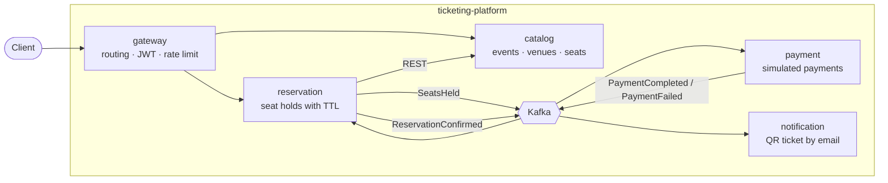

# ticketing-platform

[](https://github.com/hectorplinio/ticketing-platform/actions/workflows/ci.yml)

Event ticketing platform with seat reservation, built with Java 21 and Spring Boot microservices.
It is a portfolio project focused on production-grade backend engineering: hexagonal
architecture, event-driven communication with Kafka, real-infrastructure testing and
Kubernetes deployment.

> **Project status: early stage.** The monorepo, CI and health checks are in place. The
> business domain (events, seats, reservations, payments) is being built next — see
> [What exists today](#what-exists-today) and the [roadmap](#roadmap).

---

## Table of contents

- [What it does](#what-it-does)
- [What exists today](#what-exists-today)
- [Architecture](#architecture)
- [Services](#services)
- [Tech stack](#tech-stack)
- [Getting started](#getting-started)
- [Using the platform](#using-the-platform)
- [Project structure](#project-structure)
- [Testing](#testing)
- [Development workflow](#development-workflow)
- [Troubleshooting](#troubleshooting)
- [Roadmap](#roadmap)

---

## What it does

The platform lets users buy tickets for events with assigned seating:

1. **Browse** events and venues, and see the seat map with prices.
2. **Hold** one or more seats. The hold is temporary (~10 minutes): if it is not paid in time,
   the seats are released automatically.
3. **Pay** for the reservation. Payments are simulated and fail randomly on purpose, so the
   system has to compensate (release the seats) when a payment fails.
4. **Receive the ticket** by email, with a QR code.

The hard problem at its core is **concurrency**: when two users try to hold the same seat at
the same time, exactly one must win, without double-selling and without blocking the system.

## What exists today

| Area                     | Status                                                                  |
|--------------------------|-------------------------------------------------------------------------|
| Gradle monorepo, 5 services | ✅ Skeletons that start and pass their tests                         |
| CI (GitHub Actions)      | ✅ Format check + build + tests on every PR                              |
| Code formatting          | ✅ Spotless with palantir-java-format                                    |
| Local infrastructure     | ✅ docker-compose with Kafka, Postgres, Redis and Mailpit                |
| Health checks            | ✅ `/health/<service>` through the gateway, aware of DB and Kafka        |
| Gateway security         | ✅ Health is public, everything else requires authentication            |
| Business domain and APIs | ⏳ Not yet — catalog and reservation are next                           |
| Keycloak (JWT), rate limiting, Kubernetes, observability | ⏳ Planned                              |

## Architecture



Key design decisions:

- **Single entry point.** Clients only talk to the gateway, which routes requests, validates
  JWTs and applies rate limiting.
- **Synchronous REST only when needed.** A service calls another directly only when it needs
  the answer right now (e.g. reservation asks catalog for a seat's price).
- **Asynchronous Kafka for everything else**, as a choreographed saga (no central orchestrator):

  ```
  reservation ──SeatsHeld──────────▶ payment
  payment ─────PaymentCompleted────▶ reservation ──ReservationConfirmed──▶ notification
  payment ─────PaymentFailed───────▶ reservation (releases seats)
  reservation ─ReservationExpired──▶ (seats released by TTL)
  ```

- **Reliable messaging.** Events are published with the **Outbox pattern** (state change and
  event stored in the same transaction), consumers are **idempotent** (duplicates are
  ignored) and failed messages go to a **dead-letter queue**.
- **Database per service.** Each service owns its PostgreSQL database; no shared tables.
- **Hexagonal architecture** in business services: a pure-Java `domain`, use cases in
  `application`, and adapters (REST, Kafka, JPA) in `infrastructure`.

## Services

| Service      | App port | Mgmt port | Database    | Responsibility                                                  |
|--------------|----------|-----------|-------------|-----------------------------------------------------------------|
| gateway      | 8080     | 9080      | —           | Single entry point: routing, JWT validation, rate limiting      |
| catalog      | 8081     | 9081      | catalog     | Events, venues, seat maps, prices                               |
| reservation  | 8082     | 9082      | reservation | Seat holds with TTL, concurrency control, release of expired holds |
| payment      | 8083     | 9083      | payment     | Simulated payments that fail randomly to exercise compensation  |
| notification | 8084     | 9084      | —           | Ticket with QR code sent by email                               |

The **management port** serves Actuator (health, probes) separately from the business API,
so business routes can never expose `/actuator/*` by accident.

## Tech stack

| Area          | Choice                                                                |
|---------------|-----------------------------------------------------------------------|
| Language      | Java 21                                                               |
| Framework     | Spring Boot 4.1, Spring Cloud Gateway (reactive, WebFlux)             |
| Build         | Gradle 9 (Kotlin DSL), multi-module monorepo                          |
| Formatting    | Spotless + palantir-java-format                                       |
| Messaging     | Apache Kafka (KRaft mode, no ZooKeeper)                               |
| Data          | PostgreSQL 17 + Flyway migrations, Redis 7                            |
| Email (local) | Mailpit                                                               |
| Testing       | JUnit 5, Testcontainers (real Kafka and Postgres in Docker)           |
| CI            | GitHub Actions, Dependabot                                            |
| Planned       | Keycloak (OIDC), OpenTelemetry + Grafana, Kubernetes + Helm, ArchUnit |

## Getting started

### Prerequisites

- **Java 21** (e.g. Temurin; the repo uses [mise](https://mise.jdx.dev/) locally)
- **Docker** running (needed for the local infrastructure and for the tests)
- Nothing else: Gradle is provided by the wrapper (`./gradlew`)

### 1. Clone and build

```bash
git clone https://github.com/hectorplinio/ticketing-platform.git
cd ticketing-platform
./gradlew build
```

`build` compiles every service, runs the tests (they start their own containers with
Testcontainers) and checks the formatting.

### 2. Start the local infrastructure

```bash
docker compose -f infra/docker-compose.yml up -d
```

| Component | Address                                                       |
|-----------|---------------------------------------------------------------|
| Kafka     | `localhost:9092`                                              |
| Postgres  | `localhost:5432` — user `ticketing`, password `ticketing` (local only); databases `catalog`, `reservation`, `payment` |
| Redis     | `localhost:6379`                                              |
| Mailpit   | SMTP `localhost:1025`, web UI http://localhost:8025           |

### 3. Run the services

Each service runs in its own terminal:

```bash
./gradlew :services:gateway:bootRun

./gradlew :services:catalog:bootTestRun
./gradlew :services:reservation:bootTestRun
./gradlew :services:payment:bootTestRun
./gradlew :services:notification:bootTestRun
```

> **Why `bootTestRun` for business services?** They don't have a datasource configured yet, so
> `bootTestRun` starts them with their own Kafka and Postgres containers (Testcontainers),
> the same ones the tests use. Once their configuration points to the docker-compose
> infrastructure, `bootRun` will work too.

### 4. Check that everything is up

```bash
for s in gateway catalog reservation payment notification; do
  echo "$s: $(curl -s http://localhost:8080/health/$s)"
done
```

Every service should answer `{"status":"UP"}`.

## Using the platform

### Health checks

Health is reachable externally **only** through the gateway, one route per service:

| Request                                     | Healthy response              |
|---------------------------------------------|-------------------------------|
| `GET http://localhost:8080/health/gateway`      | `200 {"status":"UP"}` |
| `GET http://localhost:8080/health/catalog`      | `200 {"status":"UP"}` |
| `GET http://localhost:8080/health/reservation`  | `200 {"status":"UP"}` |
| `GET http://localhost:8080/health/payment`      | `200 {"status":"UP"}` |
| `GET http://localhost:8080/health/notification` | `200 {"status":"UP"}` |

Each route targets the service's **readiness** check, which includes its dependencies:

| Situation                              | Response                                |
|----------------------------------------|-----------------------------------------|
| Service and dependencies working       | `200 {"status":"UP"}`                   |
| Kafka or the database unavailable      | `503 {"status":"DOWN"}`                 |
| Service not answering within 2 seconds | `504 Gateway Timeout` (from the gateway) |

Details are never shown externally, only the status. Kubernetes probes will hit the
management port directly: `/actuator/health/liveness` and `/actuator/health/readiness`.

### Business API

Not available yet. Endpoints for events, seats and reservations will be documented here as
they are built (phase 1).

### Authentication

Any route other than `/health/**` currently returns `401 Unauthorized`. JWT validation with
Keycloak is planned for phase 2.

## Project structure

```
ticketing-platform/
├── build.gradle.kts           # shared config: group/version, Spotless for all services
├── settings.gradle.kts        # declares the five service modules
├── gradle/wrapper/            # Gradle wrapper (the only one in the repo)
├── infra/
│   ├── docker-compose.yml     # Kafka, Postgres, Redis, Mailpit
│   └── postgres/init.sql      # creates one database per service
├── services/
│   ├── gateway/               # config/ and filter/ only (no domain)
│   ├── catalog/
│   ├── reservation/
│   ├── payment/
│   └── notification/
└── .github/                   # CI workflow and Dependabot
```

Business services follow hexagonal architecture:

```
com.hector.ticketing.<service>/
├── domain/            # pure Java: entities, value objects, domain events, repository interfaces
├── application/       # use cases (e.g. HoldSeats, ConfirmReservation)
└── infrastructure/
    ├── input/         # REST controllers, Kafka consumers
    ├── output/        # JPA persistence, Kafka publishing, REST clients
    └── config/        # Spring wiring
```

The rule: `domain` depends on nothing, `application` depends only on `domain`, and Spring,
JPA and Kafka live only in `infrastructure`.

## Testing

```bash
./gradlew build                          # everything: compile, tests, format check
./gradlew test                           # tests only
./gradlew :services:catalog:test         # one service
```

Tests run against **real infrastructure** (Kafka and Postgres in Docker via Testcontainers)
instead of mocks or in-memory databases, so Docker must be running.

## Development workflow

- `master` is protected: changes go through a branch and a pull request, and CI must pass
  before merging (squash merge).
- Branch names: `feat/...`, `fix/...`, `chore/...`, `docs/...`, `build/...`, `test/...`.
- Commits follow [Conventional Commits](https://www.conventionalcommits.org/) in English:
  `feat:`, `fix:`, `chore:`, `build:`, `docs:`, `test:`, `refactor:`.
- Format before committing:

  ```bash
  ./gradlew spotlessApply
  ```

- Never commit secrets: `.env` is gitignored.

## Troubleshooting

| Problem                                         | Solution                                                    |
|-------------------------------------------------|-------------------------------------------------------------|
| Tests fail with a Docker / Testcontainers error | Make sure Docker is running.                                |
| `Port 808x/908x already in use`                 | Another instance is running: `lsof -i :8081` and stop it.   |
| `/health/<service>` returns `503` with `DOWN`   | The service is up but its database or Kafka is not reachable. |
| `/health/<service>` returns `504`               | The service is not responding in time (or its database is hung). |
| `spotlessCheck` fails in the build              | Run `./gradlew spotlessApply` and commit the result.        |
| A database from `init.sql` is missing           | The script only runs on an empty volume: `docker compose -f infra/docker-compose.yml down -v` and start again (this deletes local data). |

## Roadmap

| Phase | Deliverable                                                                    | Status  |
|-------|--------------------------------------------------------------------------------|---------|
| 0     | Monorepo skeleton, docker-compose, Spotless, CI, Dependabot, branch protection | ✅ Done |
| 0.5   | Health checks: management ports, gateway `/health/*` routes, security config   | ✅ Done |
| 1     | catalog + reservation domain: seat holds, TTL expiry, concurrency control      | 🔄 Next |
| 2     | Gateway business routes, Keycloak JWT, Redis rate limiting                     | Planned |
| 3     | payment + full saga with Outbox, idempotent consumers and DLQ                  | Planned |
| 4     | notification: QR ticket and email                                              | Planned |
| 5     | OpenTelemetry tracing across Kafka, Grafana dashboards                         | Planned |
| 6     | Docker images, Helm charts, deploy to a local Kubernetes cluster from CI       | Planned |
